  

  
  
  
  
  

  

### `$ ls ~/projetos`

  
  
  

Carrega num cartão para ver as capturas e os vídeos no portfólio · o próprio <a href="https://github.com/nuryansultane/nuryansultane.github.io">portfólio</a> também é um projeto: HTML, CSS, JavaScript e GSAP.

### `$ cat stack.txt`

  

---

<b>In English:</b> full-stack developer from Mozambique building management systems and web applications with TypeScript, React, Laravel and Node.js. Open to freelance work and full-time roles.

Os painéis são gerados por <code>scripts/painel.py</code>; as contribuições atualizam-se todos os dias pelo GitHub Actions.
